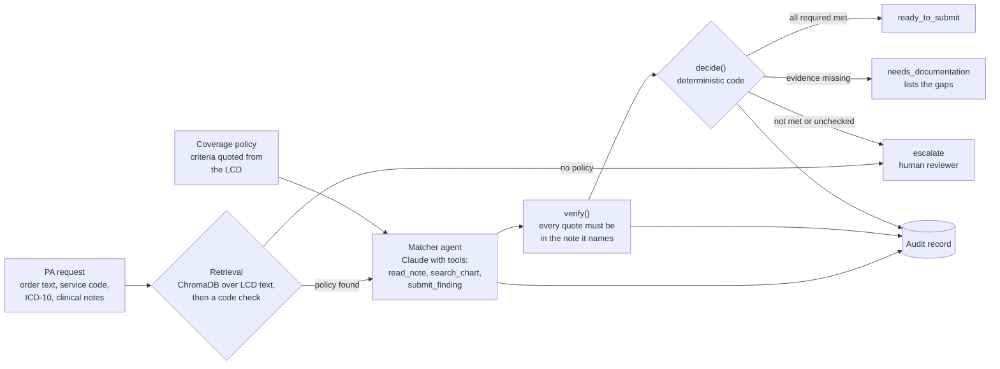
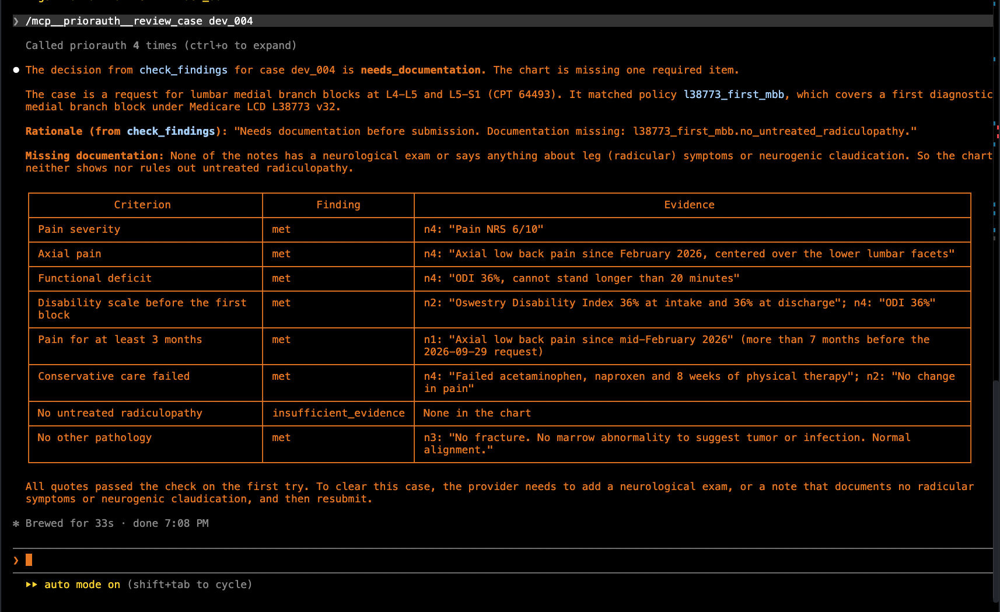

# PriorAuth-AI

[](https://github.com/shilpamusale/priorauth-ai/actions/workflows/ci.yml)

**[Live demo](https://priorauth-ai-140535548045.us-central1.run.app)** · recorded runs of the agent on synthetic charts, replayed through the real pipeline, and policy retrieval you can try

An agentic prior-authorization workflow with an evaluation harness, built from the provider side: given
an ordered service and a patient's clinical notes, decide whether the request is ready to submit to the
payer, which documentation is missing, or whether a human needs to look at it.

> **Status:** every planned phase is built and tested in CI, and the final held-out run is done (Nov 15,
> 2026). Next steps are in the [error analysis](docs/error_analysis.md) and the [Roadmap](#roadmap). All
> patients are synthetic; no PHI is used anywhere.

## At a glance

| | Dev set (used while building) | Held-out set (run once, at the end) |
|---|---|---|
| Decisions | 51 of 51 runs right (17 cases × 3 trials) | 21 of 21 runs right (7 cases × 3 trials) |
| Criteria | 367 of 372 statuses match the gold labels | 156 of 156 |
| Hard-gate failures | 0 | 0 |
| Retrieval | 23 of 24 routed right, none to a policy it should not reach | 9 of 10 routed right, none unsafe |
| Cost | about $0.03 a run | $0.61 for 21 runs |

- **Second policy:** added with no change to the engine; 9 of 9 dev runs and 3 of 3 held-out runs right.
- **Multi-agent:** one agent per criterion cost about 3.5 times as much per run and was not more accurate,
  so the single agent is deployed.
- **LLM judge:** agrees with blind hand labels on 27 of 32 evidence items (Cohen's kappa 0.71).
- **Human review:** of the 7 dev cases queued for a person, 3 agree with the gold labels and 4 question a
  criterion label; one label was changed as a result.
- **Fresh routing requests:** 13 of 19 routed right, with 2 unsafe routes where the order and the code
  disagree. Hybrid keyword search did not fix them and is not adopted; see
  [Hybrid retrieval and the fresh routing requests](#hybrid-retrieval-and-the-fresh-routing-requests).

## Why provider-side

Most prior-authorization demos play the payer and approve or deny. Provider revenue-cycle teams have a
different job: get the request right before it is submitted, because a request missing documentation
comes back as a denial and costs days of rework. That is the workflow this project automates, and the
one I worked on at R1 RCM.

## How it works



0. **Retrieval** finds the coverage policy from the order, in the clinician's words. ChromaDB ranks
   passages of the indexed LCDs by how close they are to the order; the closest LCD must be within a
   distance limit, a policy must be built on it, and that policy must cover the requested service code.
   Otherwise the request goes to a person, with the reason and no model call.
1. **The matcher agent** (Claude, strict tool use) sees the request, the policy criteria and a list of
   the notes, but not their text. It reads notes and searches the chart with tools, then submits one
   finding per criterion: `met`, `not_met` or `insufficient_evidence`, quoting the chart and naming the
   note. A quote that is not in the note is rejected on submission, and the model can correct it.
2. **`verify()`** checks every quote again on the finished findings. A finding with any bad quote is
   dropped, so the criterion counts as unchecked.
3. **`decide()`** turns the grounded findings into the decision in plain code. The model never makes the
   final call.
4. **The audit record** keeps the determination, the policy and prompt fingerprints, the model, every
   tool call and result, token use, and anything skipped or rejected.
5. **The documentation agent** turns each gap into a request to the clinic: what this chart already
   records, what it lacks, and which note should carry it. It never changes a finding or the decision.
6. **Human review** takes every case the agent escalated or whose trials disagree. The reviewer corrects
   facts, one criterion at a time with a reason (and a quote checked against the note for anything marked
   met), and `decide()` runs again. Reviews become candidate gold cases.

## Design decisions

| Decision | Why |
|---|---|
| The decision is computed in code, not generated | Auditable, reproducible, and an instruction hidden in a note cannot change it |
| Retrieval proposes the policy; code checks it | The requested code must be one the policy covers, so a close-sounding order cannot send a request to the wrong policy |
| Anything not clearly met goes to a human | A wrong "ready to submit" becomes a denial; a wrong escalation costs a reviewer a few minutes |
| A reviewer corrects facts, not the decision | Reviews have no decision field; `decide()` runs on the reviewed findings, so a person and the agent are held to the same rule |
| A skipped or unverified required criterion escalates | The pipeline never assumes a criterion it did not check |
| Every quote is checked twice: when the model submits it, and again before deciding | Grounding is enforced by string match, not by trusting the model |
| Criterion and note IDs are enums in strict tool schemas | The API itself stops the model from citing another policy's criterion or a note that does not exist |
| Every policy criterion quotes its LCD | Checked when policies load, so a criterion cannot drift from the published policy |
| Policies are data, not code | Service names, codes, criteria and thresholds live in `policies/`; the prompt contains no numbers (a test enforces it). The second policy was added with no change to `src/` |
| Replay is strict | A recording replays only for the exact request it was made for, so CI never scores a version of the agent that was not run |
| Held-out cases are refused unless the final evaluation asks for them | The rule against tuning on held-out cases is enforced in code |
| Synthetic patients, public policies | No PHI; real coverage documents keep the problem realistic |

## Evaluation

Gold cases are written and committed before the agent runs on them. Each case is run three times,
because the agent is not deterministic. Live runs are recorded once; CI replays the recordings through
the current code with no API key and fails the build on any hard-gate failure.

- **Gold set:** 24 synthetic multi-note charts, 17 dev cases and 7 held out until the final run. 20 are on
  LCD L38773 (first lumbar medial branch block) and cover each decision, documentation gaps, clinic
  shorthand spread across notes, a copied-forward stale note, an old diagnosis since resolved, and a prompt
  injection inside a referral letter. 4 are on LCD L33944 (upper eyelid blepharoplasty), the second policy.
  Each case carries the order as the clinician wrote it, for retrieval.
- **Checks:**

| Check | Fails when |
|---|---|
| `decision_correct` | The decision differs from the gold case |
| `criteria_correct` | Any criterion's status differs from the gold labels (no finding counts as wrong) |
| `evidence_notes_match` | A met criterion cites none of the notes the gold label names |
| `evidence_grounded` (hard gate) | A quote does not appear in the note it names |
| `ready_requires_all_met` (hard gate) | `ready_to_submit` while a required criterion lacks a met finding |
| `decision_follows_criteria` (hard gate) | The decision is not the one the output's own criteria imply |

**Dev set baseline** (claude-sonnet-5-5, prompt `matcher_v1`, 17 cases × 3 trials, recorded Nov 14-15, 2026):

| Metric | Value |
|---|---|
| Decision accuracy | 1.00 (51 of 51 trials) |
| Criterion accuracy | 0.99 (367 of 372 criterion labels) |
| Hard-gate failures | 0 |
| Cases whose trials reached different decisions | 0 of 17 |
| Cost | $1.42 for 51 runs, about $0.03 per run |
| Model calls per run | 2: read the notes, then submit every finding |

These are dev cases, written and used while building, so they show the pipeline works rather than how
well it generalizes; the held-out results are further down. Every criterion miss is about where one
criterion ends and another begins, not about grounding. In one trial the model asked for a scored
disability scale before calling a functional deficit met (the policy accepts a pain score with described
limits), and in another it counted an untreated radiculopathy against "no other pathology", although
radiculopathy has its own criterion. The other three are dev_011's pain severity, which the agent called
met in every trial; after the held-out run that label became insufficient evidence, on the doubts of the
human review, the multi-agent pipeline and the judge (370 of 372 before the change). No miss changed a
decision.

CI replays these recordings on every pull request and fails below 0.95 decision accuracy or on any
hard-gate failure.

**Single agent vs. multi-agent** (the 14 facet dev cases; multi-agent recorded once per case, Nov 14, 2026;
the blepharoplasty cases, added later, are 3 of 3 for both):

| | Single agent | Multi-agent: one evidence agent per criterion, in parallel |
|---|---|---|
| Decisions correct | 42 of 42 (14 of 14 on trial 1) | 14 of 14 |
| Cases with every criterion right | 37 of 42 (13 of 14 on trial 1) | 13 of 14 |
| Hard-gate failures | 0 | 0 |
| Model calls per case | 2 | 16 to 19 |
| Tokens per case | about 5.3k in, 1.9k out | about 36k in, 3.8k out |
| Cost per case | $0.03 | $0.11 |

Splitting the work cost 3.7 times as much and was not more accurate, so the single agent is the one
deployed. Each evidence agent uses the single agent's prompt and tools on a one-criterion view of the
policy, so the comparison measures the orchestration alone. The multi-agent pipeline repeated the single
agent's radiculopathy slip on dev_009 (counting it against "no other pathology", which has its own
criterion), which points to how the criteria are worded rather than to one agent handling eight criteria.
On dev_011 it would not treat a pain score that covers mostly buttock and thigh pain as a low-back score;
that reading later became the gold label, so it counts as right and the single agent's trials as wrong.
Both recordings replay in CI, and the demo can show either pipeline.

**Documentation agent** (on the single agent's first trial of each dev case): 7 dev cases had
documentation gaps, and the agent wrote 8 requests, one per gap, for $0.04 in total. Each says what the
chart already records and what it lacks, and names the note that should carry it, for example on dev_004:
"Please document a lower-extremity neurological exam (strength, sensation, reflexes, straight leg raise)."
None invents a result or asks for a particular score. CI replays the requests and fails if a gap is left
without one; the LLM judge below grades their quality.

**Second policy, with no engine change** (LCD L33944, upper eyelid blepharoplasty): a different specialty,
with criteria that rest on the eyelid exam, the patient's complaint and visual field results with the lids
at rest and taped up. Adding it took a policy file whose criteria quote the LCD and 4 gold cases, written
before any run; nothing in `src/` changed. On the first recording the single agent reached the expected
decision in 9 of 9 trials and the multi-agent pipeline in 3 of 3, with every criterion right, and the
documentation agent asked for exactly the missing taped visual field test. The judge stays on the facet
policy, because its calibration was measured on facet labels.

**Retrieval** (ChromaDB with its default local embedding model, all-MiniLM-L6-v2; no language model): each
dev case's order must reach its policy, and 7 routing-only requests must go to a person for the stated
reason: an LCD that is indexed but has no policy here (varicose veins), a service code the policy does not
cover (lumbar radiofrequency ablation, an eyelid order with a facet code, a facet order with an eyelid code),
or no LCD close enough (knee replacement, cataract surgery).

| Retrieval on the dev requests | Value |
|---|---|
| Routed right | 23 of 24 (96%) |
| Unsafe routes (reached a policy they should not) | 0 |
| Distance of matched orders to their LCD | 0.22 to 0.60 |
| Distance of the closest unrelated order | 0.617 (cataract surgery, to the eyelid LCD) |

The miss is dev_002's order, "Dx MBB L4-5, L5-S1": the general-purpose embedding model does not know the
clinic shorthand, and the order lands farther from the facet LCD (0.678) than the knee replacement does. It
escalates to a person, which is the safe way to fail. The distance limit, 0.61, was chosen on the dev
requests only, and the margin is thin; the held-out requests will test it. CI rebuilds the index and fails
on any unsafe route or below 95% routed right.

**LLM judge** (claude-opus-5-5, prompt `judge_v1`): the string match proves a quote is in the chart, not
that it supports the criterion. The judge reads each met finding's quotes, and only the notes they cite,
and grades the evidence `supports`, `partly` or `does_not_support`. For each documentation request it
answers four yes/no checks (specific, asks only for what is needed, invents nothing, says where to put
it), and code turns them into `acceptable` or `needs_revision`. To measure how far to trust it, I
labelled 40 items blind on a local page before the judge ran: 24 of the agent's evidence findings,
8 planted mismatches (a criterion paired with another criterion's evidence) and the 8 requests. The page
never shows which kind an item is.

| Judge vs. my labels | Agreed | Cohen's kappa |
|---|---|---|
| Evidence and planted, three grades | 27 of 32 (84%) | 0.71 |
| Evidence and planted, supports or not | 28 of 32 (88%) | 0.74 |
| Planted mismatches caught | judge 8 of 8, me 8 of 8 | |
| Documentation requests | 8 of 8 | undefined: both of us found every request acceptable |

What the disagreements show:

- **The judge is more lenient on `partly`.** Four of the five disagreements are evidence I graded
  `partly` and the judge graded `supports`: two baseline disability scores with nothing showing they came
  before the block, and two "no untreated radiculopathy" findings that say nothing about neurogenic
  claudication.
- **It applies its rubric unevenly.** On the unlabelled items it graded those same gaps `partly`
  (baseline timing on dev_002 and dev_013, claudication on dev_008).
- **It lacks one piece of context.** The judge is not shown the request date, so on dev_008 and dev_010
  it measured pain duration to the note date and graded the evidence `does_not_support`. That is a
  judge bug, not an agent error, and the first change for a `judge_v2`.
- **It raises the same question on dev_011** that the multi-agent pipeline did: it graded the single
  agent's pain score `partly` because most of that pain is in the buttock and thigh, as I did.
- **The request sample cannot measure it.** With no bad request in the sample, kappa is undefined;
  planted bad requests would be needed.

Over all 99 evidence findings the judge graded 91 `supports`, 6 `partly` and 2 `does_not_support` (the two
duration false alarms), for $1.13 across 115 items. I have not tuned the judge on these 40 labels: a
`judge_v2` would need fresh labels to be measured fairly. CI replays the judge and recomputes these
numbers in a step that is allowed to fail, because the judge informs a review and never blocks a merge.

**Human review** (`ui/review.py`, a local screen; it writes files, so it is never deployed): the queue holds
every dev case the single agent escalated or whose three trials disagree, 7 of the 17. I reviewed each one
from the chart, keeping or correcting each criterion with a reason; the screen never shows the gold label.
The comparison with the gold labels runs afterwards. After it, I corrected one status that contradicted
the chart (dev_005) and two whose status did not match the reason I had written (dev_006, dev_012); the
reasons themselves were written before any comparison.

| Case | What the review found | Gold label | Review |
|---|---|---|---|
| dev_005, dev_010, dev_017 | Agrees with the agent and the gold label | | |
| dev_006, dev_012 | Functional limits are described but measured on no scale: a documentation gap | met | insufficient evidence |
| dev_011 | The NRS 7/10 rates mostly buttock and thigh pain, not the low back pain the criterion is about | met | not met |
| dev_009 | The MRI predates the new leg symptoms, so it cannot rule out a disc cause for them | met | not met |

Only dev_006's decision would change, and the review decides it the same way the gold label does
(needs documentation), for a different reason. The findings point at the gold set rather than the agent:
the agent's own trial-to-trial disagreements on dev_006 and dev_009 are the same two judgment calls the
review made, which suggests the functional-deficit criterion is worded ambiguously. Each review is saved
in `evals/reviews/`, and `python -m evals.reviews` turns it into a candidate gold case in
`evals/gold/candidates/` and lists where it differs from the gold label. Candidates are never scored; a
label changes only when a person promotes one.

**Error analysis** ([docs/error_analysis.md](docs/error_analysis.md)), written and committed before the
held-out run: the dev misses and their causes, what the review says about them, and what will change
after the held-out run. Nothing in the system changed before it.

**Final held-out run** (recorded once on Nov 15, 2026, after the error analysis was committed; the system
frozen as the error analysis lists):

| Held-out result | Value |
|---|---|
| Decisions | 21 of 21 runs right: 7 cases (6 facet, 1 blepharoplasty) × 3 trials |
| Criteria | 156 of 156 statuses match the gold labels |
| Hard-gate failures, cases whose trials disagree | 0, 0 |
| Cost | $0.61 for 21 runs |
| Retrieval | 9 of 10 routed right, none to a policy it should not reach |

The cases expected to be hardest held in every trial: a radiculopathy the policy excuses because a facet
synovial cyst causes it, a latest note that copies forward an earlier note's scores, and a blepharoplasty
chart in clinic shorthand with the field loss in percent. Both held-out orders in shorthand ("Lumbar MBB",
"Bilat upper bleph") routed correctly. The routing miss is the thin margin the error analysis predicted:
"Anterior cervical discectomy and fusion, C5-C6" came within the distance limit of the facet LCD (0.514),
and only the code check stopped it, as `code_not_covered` rather than `no_match`. It escalated, which is
the safe outcome, and it is why retrieval only proposes and code decides. Seven cases is a small set: a
clean result shows the dev numbers were not an artifact of building on them, not how the pipeline would do
on real charts. CI replays the held-out recordings and routes too.

### Hybrid retrieval and the fresh routing requests

The error analysis proposed keyword search for the shorthand miss. Before writing it, I wrote 19 new routing
requests (`evals/gold/routing/fresh.yaml`, Nov 19, 2026) and scored them with embedding-only retrieval as the
baseline. The keyword setting was chosen on the dev requests alone.

Hybrid retrieval adds BM25 over the same LCD passages and changes only the orders the embeddings find too far.
One of those can reach an LCD if a passage holds at least 0.35 of the order's words, weighted by rarity. That
is the midpoint between the highest dev order that must not match (cataract surgery, 0.27) and dev_002 (0.43).
The policy and code checks follow as before.

| Routed right, unsafe routes | Dev (24) | Held-out (10) | Fresh (19) |
|---|---|---|---|
| Embedding only | 23, 0 | 9, 0 | 13, 2 |
| Hybrid | 24, 0 | 9, 0 | 13, 2 |

- **Hybrid fixed dev_002's "Dx MBB" and changed nothing else.** The only fresh order the embeddings rejected,
  carpal tunnel release, has no keyword match (0.15).
- **It is not adopted, because keywords cannot tell what an LCD governs from what it mentions.** On the fresh
  requests, orders the facet LCD does not govern outscore one it does: sacroiliac joint injection 0.64 and
  epidural steroid injection 0.61, against 0.24 for "Dx lumbar MBB". A keyword path into a policy would rest
  on a signal that cannot separate them. It stays available as `--retrieval hybrid` and
  `python -m evals.routing --compare`.

**What the fresh requests found.** The dev set's unrelated orders were far from every LCD: a knee replacement
and cataract surgery. The fresh set adds procedures close to the facet LCD, and embedding retrieval accepted
four of the five that no indexed LCD governs: an epidural injection (at 0.318, closer than most facet orders),
a sacroiliac joint injection, a genicular nerve ablation and a spinal fusion. They escalated as
`code_not_covered`, which is safe. Two requests whose order and code disagree did not escalate:

- an epidural order with facet code 64493 reached the facet policy;
- cataract surgery with eyelid code 15823 reached the blepharoplasty policy, at 0.608, inside the limit by
  0.002.

The held-out cervical fusion order was the first sign: the code check stopped it only because its code was not
covered. When the code is covered, nothing checks that the order describes the service the policy decides.
That check comes next, measured on requests written after it, since these have now been seen.

## Demo and API

- **Public demo** ([link](https://priorauth-ai-140535548045.us-central1.run.app)): replays recorded runs and
  never calls a language model. Every recording is a real Claude run, replayed through the same code CI
  tests, so a visitor sees exactly what was evaluated, cannot run up a bill, and the image holds no API key
  or model SDK. Each case shows the route retrieval found for its order, and visitors can type an order and
  a code to try retrieval themselves; the embedding model is built into the image. On the single agent's
  first trial the demo also shows the LLM judge's grade and reasoning for each met criterion and each
  request to the clinic, false alarms included.
- **Private API** (FastAPI on Cloud Run, Google sign-in required): runs the live pipeline.
  `POST /requests` takes a request, finds its policy with retrieval and returns the route with the audit
  record; a request that reaches no policy returns the reason at once, with no model call.
  `POST /determinations` takes a named policy instead, and refuses one that does not cover the request's
  code. `GET /policies` lists policies with their fingerprints; interactive docs are at `/docs`. A daily
  run limit caps spending, the Anthropic workspace's monthly limit is the hard backstop, and the API key
  is read from Secret Manager at run time.
- **Claude API or Amazon Bedrock.** The same client runs on either: Bedrock serves Claude at an
  Anthropic-compatible endpoint, so only the URL, the key and the model ID change (`priorauth/llm/providers.py`).
  Requests keep the model's own name, so recordings, fingerprints and costs do not depend on the provider.
  `PRIORAUTH_PROVIDER=bedrock` serves the API from Bedrock; `--provider bedrock` records an evaluation there,
  under `evals/recordings/bedrock/`, and `python -m evals.providers` scores both sets of recordings side by side.

## MCP server

`python -m priorauth.mcp_server` offers PriorAuth-AI's code-side steps as tools to any MCP client, such as
Claude Code or Claude Desktop. The split stays the same as in the agent: the client's model reads the chart
and judges each criterion with verbatim quotes, and `check_findings` checks every quote and makes the
decision with the same verify-and-decide code the agent's runs go through (`pipeline.determine`). A test sends
it the findings from all 51 recorded dev runs and gets back the recorded decision every time.

| Tool | What it does |
|---|---|
| `list_policies`, `get_policy` | The policies, their LCD versions and fingerprints, and each criterion with the LCD's words |
| `find_policy` | Retrieval and the code check: the policy for an order and a code, or why the request needs a person |
| `list_cases`, `get_case` | The synthetic dev charts, without their gold labels (held-out cases are not served) |
| `check_findings` | Verifies every quote against its note, then decides: the same code as the pipeline |

The `review_case` prompt runs the whole workflow on one case. Every tool is read-only: the server calls no
model, needs no API key and saves nothing, and a chart passed to `check_findings` stays in memory. Use synthetic
charts only, because the client's model reads every chart it is given.

```bash
make install                                   # includes the mcp extra
# Claude Code: add the server, check it connected, then run the prompt on a case
claude mcp add --transport stdio priorauth -- "$(pwd)/.venv/bin/python" -m priorauth.mcp_server
claude mcp list
# in a session (Claude Code lists the prompt as /priorauth:review_case; this spelling runs it):
#   /mcp__priorauth__review_case dev_004
```



Claude Code (Opus 5.5) reviewing dev_004 through the server: four tool calls, every quote verified on the first
try, and code decided `needs_documentation`. All 8 criterion statuses and the decision match the gold label
and the agent's three recorded trials. This is one case and one run, so it is a demo, not an evaluation.

For Claude Desktop, add the server under Settings → Developer → Edit Config, with absolute paths, and restart:

```json
{"mcpServers": {"priorauth": {"command": "/path/to/priorauth-ai/.venv/bin/python",
                              "args": ["-m", "priorauth.mcp_server"]}}}
```

## Quickstart

```bash
python -m venv .venv && source .venv/bin/activate
make install
make test                                      # unit tests, no API key needed
python -m evals.runner replay                  # score the committed recordings, no API key needed
python -m evals.runner replay --split heldout --allow-heldout   # the final held-out run, replayed
python -m evals.runner replay --track          # ...and log the run to MLflow (local mlflow.db)
python -m evals.gaps replay                    # the documentation agent's requests, replayed
python -m evals.calibration                    # the LLM judge against the hand labels, replayed
python -m evals.routing --min-accuracy 0.95    # retrieval on the dev requests (downloads the embedding model)
python -m evals.routing --split fresh --compare   # embedding-only and hybrid retrieval on the fresh requests
python -m streamlit run ui/app.py              # the demo, locally
python -m streamlit run ui/review.py           # the reviewer screen (local; saves to evals/reviews/)
python -m evals.reviews                        # the review queue, and candidate gold cases from reviews
uvicorn priorauth.api:app --port 8000          # the API, locally (live runs need ANTHROPIC_API_KEY)

# live runs need ANTHROPIC_API_KEY
python -m evals.runner record --cases dev_001 --trials 1

# the same run on Amazon Bedrock: needs AWS_BEARER_TOKEN_BEDROCK (a Bedrock API key), or AWS credentials
# and `pip install -e ".[bedrock]"` to make a short-lived key; AWS_REGION defaults to us-east-1
python -m evals.runner record --provider bedrock --cases dev_001 --trials 1
python -m evals.providers                      # Claude API and Bedrock recordings, scored side by side

# extract a new LCD version (the PDF stays out of the repo)
python -m priorauth.ingest path/to/LCD.pdf policies/sources/l38773_v32.txt
```

## Repository layout

```
src/priorauth/
  schemas.py      typed contracts for every handoff (Pydantic)
  policies.py     policy loader: ID rules, quotes checked against the LCD, fingerprint
  ingest.py       extracts the coverage section of an LCD PDF
  llm/            model interface, Claude adapter, providers (Claude API or Bedrock), scripted and
                  record/replay clients
  tools.py        the agent's chart tools and quote checks at submission
  matcher.py      bounded tool loop; prompts/ holds the versioned prompt
  verify.py       final grounding check
  decision.py     deterministic decision rule
  orchestrator.py multi-agent matching: one evidence agent per criterion, in parallel
  documentation.py  documentation agent: a request to the clinic for each gap
  pipeline.py     match, verify, decide, and the audit record
  retrieval.py    ChromaDB index over the LCD texts, and the route: a policy, or why not
  review.py       human review: overrides with reasons and checked quotes, then decide() again
  api.py          FastAPI service with a daily run limit
  mcp_server.py   MCP server: policy lookup, synthetic charts and check_findings, decided in code
policies/         the facet (LCD L38773) and blepharoplasty (LCD L33944) policies; sources/ holds the
                  extracted text of every indexed LCD, which criteria quote and retrieval searches
evals/
  gold/           dev and held-out cases; routing/ holds the routing-only requests (dev, held-out, fresh);
                  candidates/ holds candidate gold cases from reviews, never scored
  recordings/     recorded live runs, replayed in CI and in the demo
  checks.py, runner.py, scoring.py   checks, record/replay runner, metrics and the CI gate
  tracking.py     MLflow logging of each evaluation run
  providers.py    the same evaluation on the Claude API and on Bedrock, compared
  gaps.py         runs the documentation agent on the dev cases with gaps
  routing.py      scores retrieval: each request reaches its policy or goes to a person for the stated reason
  judge_items.py, judge.py, calibration.py   items to grade, the LLM judge, and its agreement with hand labels
  judge/          the blind-labelled sample
  reviews.py      the review queue, saved reviews, and the candidate gold cases they become
  reviews/        the saved reviews
ui/               Streamlit demo; local pages for labelling the judge sample and for review
tests/            unit tests for every module, policy and gold case
```

## Roadmap

- [x] Contracts, decision rule, CI
- [x] Policy ingestion from LCD PDFs; first real policy (LCD L38773) with every criterion quoting the LCD
- [x] Multi-note synthetic charts and a gold set (now 24 cases, 7 held out), written before the agent
- [x] Criteria-matching agent (Claude API, strict tool use) with quote checks and an audit record
- [x] Record-and-replay evaluation runner, checks with hard gates, metrics and a CI eval gate
- [x] Public demo on Cloud Run (Docker, Streamlit) showing recorded runs
- [x] MLflow tracking of evaluation runs (params, metrics, fingerprints of the policy, prompt and gold set)
- [x] FastAPI service, deployed privately, with a daily run limit and the key in Secret Manager
- [x] Multi-agent orchestration: one evidence agent per criterion, compared with the single agent
- [x] Documentation agent: a request to the clinic for each documentation gap
- [x] LLM-as-judge grading, calibrated against blind hand labels
- [x] Policy retrieval with ChromaDB, and a second policy (LCD L33944) added with no engine change
- [x] Reviewer screen with overrides feeding candidate gold cases
- [x] Error analysis, written before the held-out run
- [x] Final held-out run: 21 of 21 decisions and every criterion right; routing 9 of 10, none unsafe
- [x] MCP server: policy lookup and code-made decisions as tools for Claude Code and Claude Desktop
- [x] Hybrid retrieval (BM25 plus embeddings), measured on fresh routing requests: not adopted

Next, from the [error analysis](docs/error_analysis.md):

- [ ] Say in the functional-deficit criterion whether described limits without a scale count (a new policy
  version, re-recorded runs)
- [ ] A scope check before a request reaches a policy: the order must describe the service the policy decides
  (two unsafe routes on the fresh routing requests), measured on new requests
- [ ] `judge_v2` shown the request date, measured on new hand labels
- [ ] A second reviewer, to measure how much of the review is one person's judgment

## Limitations

- **The held-out set is small.** 7 cases and 3 routing requests, run once. A clean result there shows the
  dev numbers were not an artifact of building on them; it does not show how the pipeline would do on real
  charts.
- **The data is small and synthetic.** 24 charts written by one person, on two policies. Real charts are
  longer, messier and scanned; nothing here measures OCR, EHR integration or volume.
- **One person labelled, reviewed and calibrated.** The gold labels, the judge's 40 hand labels and the 7
  reviews are mine. The reviews already question four gold labels; a second reviewer would measure how
  much of that is my judgment.
- **Retrieval accepts orders close to an LCD that it does not govern.** The distance limit sits between 0.597
  (the farthest dev order that should match) and 0.617 (the closest that should not), chosen on 24 dev
  requests whose unrelated orders were far from every LCD. On the fresh requests, four of five nearby spine
  and joint procedures landed inside it, and two requests whose order and code disagree reached a policy.
  Until a scope check exists, an order/code mismatch with a covered code can reach the wrong policy.
- **The judge has known blind spots.** It is lenient on partial evidence and is not shown the request date.
  Its agreement was measured on one policy.
- **Policies change.** Each policy is pinned to one LCD version; a new version means a new extraction and
  a re-check of every quote, which the loader enforces but a person must start.

## Out of scope

Payer-side adjudication, live payer or EHR integration, real patient data, and clinical use.
