# PriorAuth-AI

[](https://github.com/shilpamusale/priorauth-ai/actions/workflows/ci.yml)

An agentic prior-authorization workflow with an evaluation harness, built from the provider side:
given an ordered service and a patient's clinical notes, decide whether the request is ready to
submit to the payer, which documentation is missing, or whether a human needs to look at it.

> **Status: in progress.** The contracts, the decision rule, policy ingestion from published coverage
> documents and the first real policy are in place and tested in CI. Multi-note charts, the gold set and
> the matching agent come next (see [Roadmap](#roadmap)). All patients are synthetic; no PHI is used
> anywhere.

## Why provider-side

Most prior-authorization demos play the payer and approve or deny. Provider revenue-cycle teams have a
different job: get the request right before it is submitted, because a request missing documentation
comes back as a denial and costs days of rework. That is the workflow this project automates, and the
one I worked on at R1 RCM.

## How it works

```mermaid
flowchart LR
    A[PA request<br/>CPT/HCPCS + ICD-10 + clinical notes] --> B[Policy retrieval<br/>search over LCD text]
    B --> C[Criteria matching<br/>per-criterion status + verbatim evidence]
    C --> D{decide&#40;&#41;<br/>deterministic code}
    D -->|all required met| E[ready_to_submit]
    D -->|evidence missing| F[needs_documentation<br/>lists the gaps]
    D -->|criterion not met or skipped| G[escalate<br/>human reviewer]
    B & C & D --> H[(Audit trail)]
```



1. **Policy retrieval** finds the coverage policy for the ordered service, searching text extracted from
   public CMS Local Coverage Determinations (LCDs).
2. **Criteria matching** (Claude, tool use) judges each criterion as `met`, `not_met` or
   `insufficient_evidence`, quoting the chart verbatim and naming the note for anything marked met.
3. **`decide()`** turns those results into the decision in plain code. The model never makes the final call.
4. **Audit trail:** the policy and its fingerprint, every criterion result with its evidence, and the
   rationale are kept with each determination.

## Design decisions

| Decision | Why |
|---|---|
| The decision is computed in code, not generated | Auditable, reproducible, and an instruction hidden in a note cannot change it |
| Anything not clearly met goes to a human | A wrong "ready to submit" becomes a denial; a wrong escalation costs a reviewer a few minutes |
| A skipped required criterion escalates | The pipeline never assumes a criterion it did not check |
| Every "met" must quote the chart and name its note | Grounding is checked by string match, not by trusting the model |
| Every policy criterion quotes its LCD | Checked when policies load, so a criterion cannot drift from the published policy |
| Policies are data, not code | Service names, criteria and thresholds live in `policies/`; a new service is a new file |
| Agents run under a code orchestrator in a fixed order | Prior authorization has fixed stage dependencies and must be explainable to a payer and an auditor |
| Synthetic patients, public policies | No PHI; real coverage documents keep the problem realistic |

## Evaluation

The harness follows the approach from [VertexCare](https://github.com/shilpamusale/vertex-care): gold
cases are written and committed before the agent runs on them, each case is run several times because
the agent is non-deterministic, and CI scores recorded runs without API calls.

Planned checks, rebuilt on the real policy with the gold set:

| Check | Fails when |
|---|---|
| `decision_correct` | The decision differs from the gold case |
| `criteria_correct` | Any criterion's status differs from the gold labels |
| `evidence_grounded` | A quote does not appear in the note it names |
| `ready_requires_all_met` (hard gate) | `ready_to_submit` while a required criterion is unmet |
| `decision_follows_criteria` (hard gate) | The decision is not the one the output's own criteria imply |

The gold set will hold about 20 synthetic multi-note cases on the facet joint policy, 6 of them held out
until the final run. A first version on an illustrative policy was retired once the real policy landed.

## Quickstart

```bash
python -m venv .venv && source .venv/bin/activate
make install
make test     # unit tests, no API key needed

# extract a new LCD version (the PDF stays out of the repo)
python -m priorauth.ingest path/to/LCD.pdf policies/sources/l38773_v32.txt
```

## Repository layout

```
src/priorauth/
  schemas.py      typed contracts for every handoff (Pydantic)
  decision.py     deterministic decision rule
  policies.py     policy loader: ID rules, quotes checked against the LCD, fingerprint
  ingest.py       extracts the coverage section of an LCD PDF
policies/
  l38773_first_mbb.yaml   LCD L38773: first diagnostic lumbar medial branch block
  sources/                extracted LCD text that policy criteria quote
tests/            unit tests for every module and every policy file
```

## Roadmap

- [x] Contracts, decision rule, CI
- [x] Policy ingestion from LCD PDFs; first real policy (LCD L38773) with every criterion quoting the LCD
- [ ] Multi-note synthetic charts
- [ ] Gold set: about 20 synthetic cases, 6 held out, written before the agent
- [ ] Criteria-matching agent (Claude API, tool use) with runtime quote checks and an audit record
- [ ] Record-and-replay evaluation runner, per-stage scoring, CI eval gate, MLflow tracking
- [ ] FastAPI service and public demo on Cloud Run
- [ ] Multi-agent orchestration: one evidence agent per criterion, compared with the single agent
- [ ] LLM-as-judge grading, calibrated against human labels
- [ ] Policy retrieval with ChromaDB, and a second policy added with no code changes
- [ ] Reviewer screen with overrides feeding the gold set
- [ ] Results and error analysis

## Out of scope

Payer-side adjudication, live payer or EHR integration, real patient data, and clinical use.