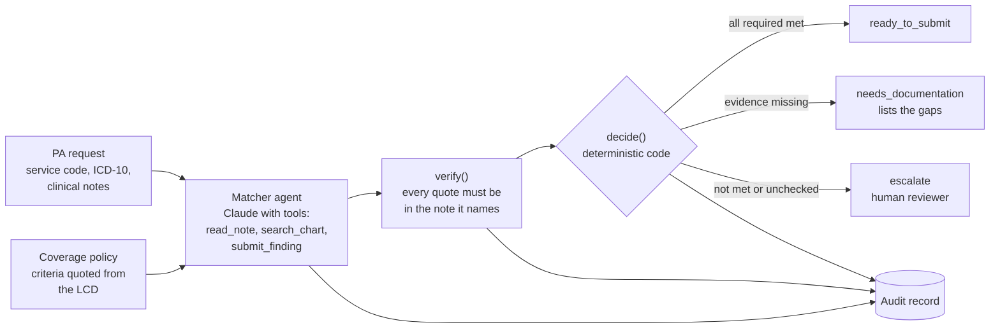

# PriorAuth-AI

[](https://github.com/shilpamusale/priorauth-ai/actions/workflows/ci.yml)

**[Live demo](https://priorauth-ai-140535548045.us-central1.run.app)** · recorded runs of the agent on synthetic charts, replayed through the real pipeline

An agentic prior-authorization workflow with an evaluation harness, built from the provider side: given
an ordered service and a patient's clinical notes, decide whether the request is ready to submit to the
payer, which documentation is missing, or whether a human needs to look at it.

> **Status: in progress.** The agent, its verification and decision steps, the evaluation harness and a
> public demo are live and tested in CI. Multi-agent orchestration, LLM-as-judge grading and policy
> retrieval come next (see [Roadmap](#roadmap)). All patients are synthetic; no PHI is used anywhere.

## Why provider-side

Most prior-authorization demos play the payer and approve or deny. Provider revenue-cycle teams have a
different job: get the request right before it is submitted, because a request missing documentation
comes back as a denial and costs days of rework. That is the workflow this project automates, and the
one I worked on at R1 RCM.

## How it works



1. **The matcher agent** (Claude, strict tool use) sees the request, the policy criteria and a list of
   the notes, but not their text. It reads notes and searches the chart with tools, then submits one
   finding per criterion: `met`, `not_met` or `insufficient_evidence`, quoting the chart and naming the
   note. A quote that is not in the note is rejected on submission, and the model can correct it.
2. **`verify()`** checks every quote again on the finished findings. A finding with any bad quote is
   dropped, so the criterion counts as unchecked.
3. **`decide()`** turns the grounded findings into the decision in plain code. The model never makes the
   final call.
4. **The audit record** keeps the determination, the policy and prompt fingerprints, the model, every
   tool call and result, token use, and anything skipped or rejected.

## Design decisions

| Decision | Why |
|---|---|
| The decision is computed in code, not generated | Auditable, reproducible, and an instruction hidden in a note cannot change it |
| Anything not clearly met goes to a human | A wrong "ready to submit" becomes a denial; a wrong escalation costs a reviewer a few minutes |
| A skipped or unverified required criterion escalates | The pipeline never assumes a criterion it did not check |
| Every quote is checked twice: when the model submits it, and again before deciding | Grounding is enforced by string match, not by trusting the model |
| Criterion and note IDs are enums in strict tool schemas | The API itself stops the model from citing another policy's criterion or a note that does not exist |
| Every policy criterion quotes its LCD | Checked when policies load, so a criterion cannot drift from the published policy |
| Policies are data, not code | Service names, criteria and thresholds live in `policies/`; the prompt contains no numbers (a test enforces it) |
| Replay is strict | A recording replays only for the exact request it was made for, so CI never scores a version of the agent that was not run |
| Held-out cases are refused unless the final evaluation asks for them | The rule against tuning on held-out cases is enforced in code |
| Synthetic patients, public policies | No PHI; real coverage documents keep the problem realistic |

## Evaluation

Gold cases are written and committed before the agent runs on them. Each case is run three times,
because the agent is not deterministic. Live runs are recorded once; CI replays the recordings through
the current code with no API key and fails the build on any hard-gate failure.

- **Gold set:** 20 synthetic multi-note charts on LCD L38773 (first lumbar medial branch block): 14 dev
  cases and 6 held out until the final run. They cover each decision, documentation gaps, clinic shorthand
  spread across notes, a copied-forward stale note, an old diagnosis since resolved, and a prompt
  injection inside a referral letter.
- **Checks:**

| Check | Fails when |
|---|---|
| `decision_correct` | The decision differs from the gold case |
| `criteria_correct` | Any criterion's status differs from the gold labels (no finding counts as wrong) |
| `evidence_notes_match` | A met criterion cites none of the notes the gold label names |
| `evidence_grounded` (hard gate) | A quote does not appear in the note it names |
| `ready_requires_all_met` (hard gate) | `ready_to_submit` while a required criterion lacks a met finding |
| `decision_follows_criteria` (hard gate) | The decision is not the one the output's own criteria imply |

**Dev set baseline** (claude-sonnet-5-5, prompt `matcher_v1`, 14 cases × 3 trials, recorded Nov 14, 2026):

| Metric | Value |
|---|---|
| Decision accuracy | 1.00 (42 of 42 trials) |
| Criterion accuracy | 0.99 (334 of 336 criterion labels) |
| Hard-gate failures | 0 |
| Cases whose trials reached different decisions | 0 of 14 |
| Cost | $1.25 for 42 runs, about $0.03 per case |
| Model calls per run | 2: read the notes, then submit every finding |

These are dev cases, written and used while building, so they show the pipeline works rather than how
well it generalizes. The 6 held-out cases run once, in the final evaluation. Both criterion misses were
about where one criterion ends and another begins, not about grounding: in one trial the model asked for
a scored disability scale before calling a functional deficit met (the policy accepts a pain score with
described limits), and in another it counted an untreated radiculopathy against "no other pathology",
although radiculopathy has its own criterion. Neither changed a decision.

CI replays these recordings on every pull request and fails below 0.95 decision accuracy or on any
hard-gate failure.

## Quickstart

```bash
python -m venv .venv && source .venv/bin/activate
make install
make test                                      # unit tests, no API key needed
python -m evals.runner replay                  # score the committed recordings, no API key needed
python -m evals.runner replay --track          # ...and log the run to MLflow (local mlflow.db)
python -m streamlit run ui/app.py              # the demo, locally

# live runs need ANTHROPIC_API_KEY
python -m evals.runner record --cases dev_001 --trials 1

# extract a new LCD version (the PDF stays out of the repo)
python -m priorauth.ingest path/to/LCD.pdf policies/sources/l38773_v32.txt
```

## Repository layout

```
src/priorauth/
  schemas.py      typed contracts for every handoff (Pydantic)
  policies.py     policy loader: ID rules, quotes checked against the LCD, fingerprint
  ingest.py       extracts the coverage section of an LCD PDF
  llm/            model interface, Claude adapter, scripted and record/replay clients
  tools.py        the agent's chart tools and quote checks at submission
  matcher.py      bounded tool loop; prompts/ holds the versioned prompt
  verify.py       final grounding check
  decision.py     deterministic decision rule
  pipeline.py     match, verify, decide, and the audit record
policies/         LCD L38773 policy and the extracted LCD text its criteria quote
evals/
  gold/           dev and held-out cases
  recordings/     recorded live runs, replayed in CI and in the demo
  checks.py, runner.py, scoring.py   checks, record/replay runner, metrics and the CI gate
  tracking.py     MLflow logging of each evaluation run
ui/               Streamlit demo
tests/            unit tests for every module, policy and gold case
```

## Roadmap

- [x] Contracts, decision rule, CI
- [x] Policy ingestion from LCD PDFs; first real policy (LCD L38773) with every criterion quoting the LCD
- [x] Multi-note synthetic charts and a gold set of 20 cases, 6 held out, written before the agent
- [x] Criteria-matching agent (Claude API, strict tool use) with quote checks and an audit record
- [x] Record-and-replay evaluation runner, checks with hard gates, metrics and a CI eval gate
- [x] Public demo on Cloud Run (Docker, Streamlit) showing recorded runs
- [x] MLflow tracking of evaluation runs (params, metrics, fingerprints of the policy, prompt and gold set)
- [ ] Live demo runs with a daily spending cap; FastAPI service
- [ ] Multi-agent orchestration: one evidence agent per criterion, compared with the single agent
- [ ] LLM-as-judge grading, calibrated against human labels
- [ ] Policy retrieval with ChromaDB, and a second policy added with no code changes
- [ ] Reviewer screen with overrides feeding the gold set
- [ ] Error analysis and the final held-out run

## Out of scope

Payer-side adjudication, live payer or EHR integration, real patient data, and clinical use.
