# PriorAuth-AI

[](https://github.com/shilpamusale/priorauth-ai/actions/workflows/ci.yml)

An agentic prior-authorization workflow with an evaluation harness, built from the provider side:
given an ordered service and a patient's clinical summary, decide whether the request is ready to
submit to the payer, which documentation is missing, or whether a human needs to look at it.

> **Status: in progress.** The contracts, the decision rule, the eval checks and a first gold set are
> in place and tested in CI. The retrieval and matching agents are being built next (see
> [Roadmap](#roadmap)). All patients are synthetic; no PHI is used anywhere.

## Why provider-side

Most prior-authorization demos play the payer and approve or deny. Provider revenue-cycle teams have a
different job: get the request right before it is submitted, because a request missing documentation
comes back as a denial and costs days of rework. That is the workflow this project automates, and the
one I worked on at R1 RCM.

## How it works

```mermaid
flowchart LR
    A[PA request<br/>CPT + ICD-10 + clinical summary] --> B[Policy retrieval<br/>RAG over coverage documents]
    B --> C[Criteria matching<br/>per-criterion status + verbatim evidence]
    C --> D{decide&#40;&#41;<br/>deterministic code}
    D -->|all required met| E[ready_to_submit]
    D -->|evidence missing| F[needs_documentation<br/>lists the gaps]
    D -->|criterion not met or skipped| G[escalate<br/>human reviewer]
    B & C & D --> H[(Audit trail)]
```



1. **Policy retrieval** finds the payer's coverage criteria for the ordered service (RAG over public CMS
   coverage documents, NCDs and LCDs).
2. **Criteria matching** (LLM, tool use) judges each criterion as `met`, `not_met` or
   `insufficient_evidence`, quoting the clinical summary verbatim for anything marked met.
3. **`decide()`** turns those results into the decision in plain code. The model never makes the final call.
4. **Audit trail:** the retrieved policy, every criterion result with its evidence, and the rationale are
   kept with each determination.

## Design decisions

| Decision | Why |
|---|---|
| The decision is computed in code, not generated | Auditable, reproducible, and an instruction hidden in a note cannot change it |
| Anything not clearly met goes to a human | A wrong "ready to submit" becomes a denial; a wrong escalation costs a reviewer a few minutes |
| A skipped required criterion escalates | The pipeline never assumes a criterion it did not check |
| Every "met" must quote the clinical summary | Grounding is checked by string match, not by trusting the model |
| Explicit pipeline, not autonomous agents | Prior authorization has fixed stage dependencies and must be explainable to a payer and an auditor |
| Synthetic patients, public policies | No PHI; real coverage documents keep the retrieval problem realistic |

## Evaluation

The harness follows the approach from [VertexCare](https://github.com/shilpamusale/vertex-care): gold
cases are written and committed before the agent runs on them, each case is run several times because
the agent is non-deterministic, and CI scores recorded runs without API calls.

| Check | Fails when |
|---|---|
| `decision_correct` | The decision differs from the gold case |
| `criteria_correct` | Any criterion's status differs from the gold labels |
| `evidence_grounded` | A quoted piece of evidence does not appear in the clinical summary |
| `ready_requires_all_met` (hard gate) | `ready_to_submit` while a required criterion is unmet |
| `decision_follows_criteria` (hard gate) | The decision is not the one the output's own criteria imply |

The gold set ([`evals/gold/cases.yaml`](evals/gold/cases.yaml)) validates itself on load: every case must
label every criterion, and its expected decision must follow from its labels, so authoring errors fail
before scoring. Version 1 covers each decision plus a prompt-injection case, on an illustrative policy
that real coverage documents will replace.

## Quickstart

```bash
python -m venv .venv && source .venv/bin/activate
make install
make test     # unit tests + gold-set consistency, no API key needed
```

## Repository layout

```
src/priorauth/
  schemas.py      typed contracts for every handoff (Pydantic)
  decision.py     deterministic decision rule
evals/
  schema.py       gold-set format and self-consistency validation
  checks.py       deterministic checks and hard gates
  gold/cases.yaml gold set v1
tests/            unit tests for the rule, the schemas and every check
```

## Roadmap

- [x] Contracts, decision rule, eval checks, gold set v1, CI
- [ ] Policy retrieval over CMS NCD/LCD documents (ChromaDB)
- [ ] Criteria-matching agent (Claude API, tool use, structured output)
- [ ] Record-and-replay runner, multi-trial scoring and CI eval gate
- [ ] Gold set v2: held-out cases, conflicting documentation, multiple diagnoses, more injection styles
- [ ] Human-review queue and audit-trail export
- [ ] Results and error analysis
- [ ] FHIR R4 input: map Patient, Coverage, Condition, ServiceRequest and DocumentReference bundles to the request schema; gold cases as FHIR bundles (Synthea patient context)

## Out of scope

Payer-side adjudication, live payer or EHR integration, real patient data, and clinical use.
